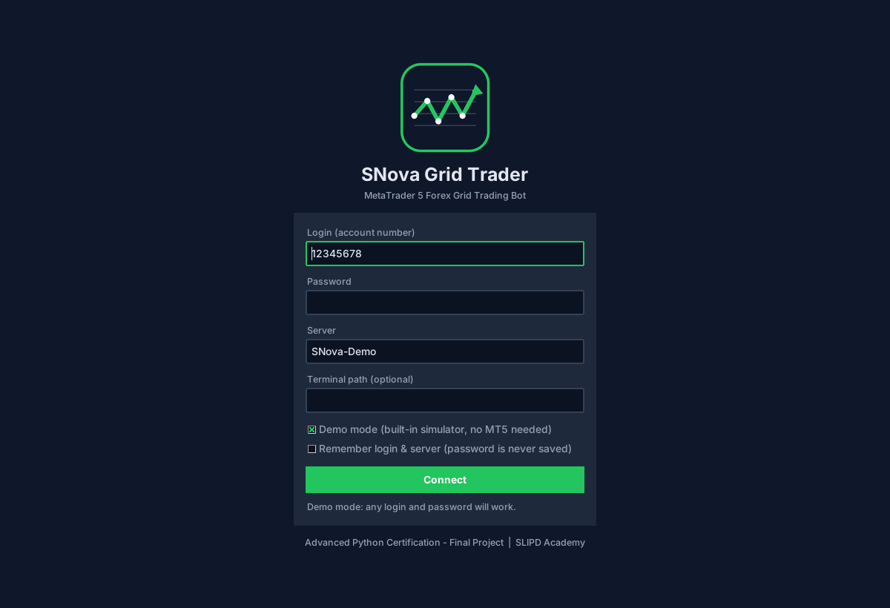
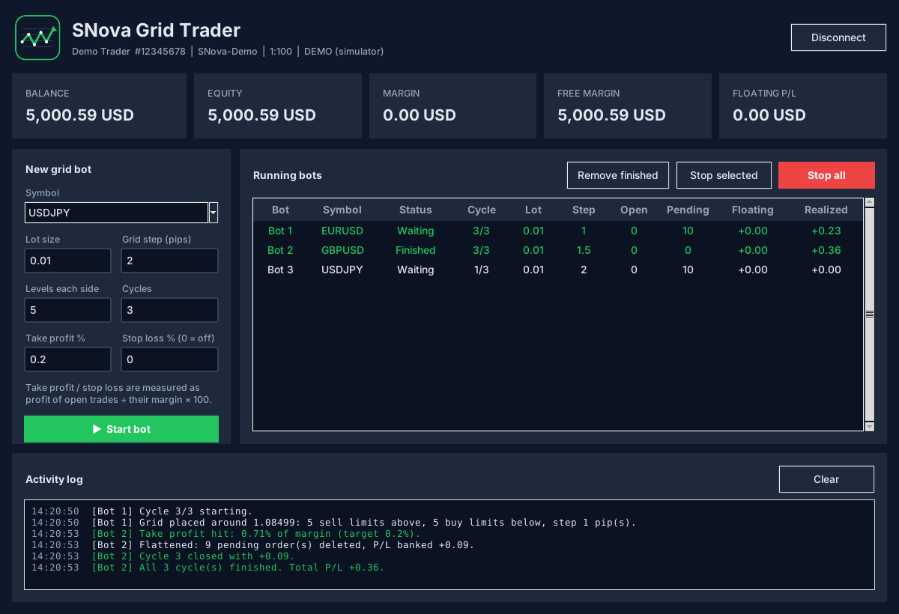

<p align="center">
  
</p>

<h1 align="center">SNova Grid Trader</h1>

<p align="center">
  A Windows desktop app that runs <b>Forex grid trading bots</b> on <b>MetaTrader 5</b>, built with Python and Tkinter.<br>
  <i>Final project for the SLIPD Academy Advanced Python Certification course.</i>
</p>

<p align="center">
  
  
  
  
</p>

---

## 📸 Screenshots

| Login | Dashboard |
|---|---|
|  |  |

---

## ✨ Features

- **Login to MetaTrader 5.** Enter your account number, password and server. The terminal starts and logs in automatically.
- **Demo mode.** A built-in market simulator, so anyone can try the app **without MetaTrader 5 or a broker account**.
- **Run many bots at once.** Each bot runs in its own **thread** with its own symbol and settings (for example EURUSD, GBPUSD and USDJPY together).
- **Safe order separation.** Every bot uses its own **magic number**, so bots never close or delete each other's orders.
- **Live account panel.** Balance, equity, margin, free margin and floating P/L update every second.
- **Bot table.** Status, cycle, open trades, pending orders, floating and realised profit for every bot, coloured green or red.
- **Take profit and stop loss** measured as a percentage of the margin used.
- **Activity log** showing everything the bots do, with timestamps.
- **Clean stop.** Stopping a bot closes its open trades and deletes its pending orders.
- **Error isolation.** If one bot hits an error, the others keep running.
- **Broker friendly.** Detects the right order filling mode for each symbol, which avoids the *"Unsupported filling mode"* error.
- **Privacy.** The app can remember your login and server, but **never saves your password**.
- **Installer.** Ships as a normal Windows `.exe` with a setup file, so Python is not needed on the target PC.

---

## 📈 How the grid strategy works

```
            SELL LIMIT  ── price + 5 steps
            SELL LIMIT  ── price + 4 steps
            SELL LIMIT  ── price + 3 steps
            SELL LIMIT  ── price + 2 steps
            SELL LIMIT  ── price + 1 step
 current price ───────────────────────────  (bid + ask) / 2
            BUY LIMIT   ── price − 1 step
            BUY LIMIT   ── price − 2 steps
            ...
```

1. The bot reads the current price and places **sell limit** orders above it and **buy limit** orders below it, one grid step apart.
2. When the market moves down and comes back (or up and comes back), the triggered orders finish **in profit overall**.
   *Example with 0.1 lot orders 1 pip apart (about $1 per pip each):* the price falls 2 pips, so the buy limits at −1 and −2 trigger. When the price comes back to where it started, they are +1 and +2 pips = **+$3**.
3. When the profit of the triggered trades reaches the **take profit %** of the margin they use, the bot closes them all and deletes the remaining pending orders.
4. It then starts the next **cycle** with a new grid around the new price.

> ⚠️ A grid strategy works best in a **ranging** market (price moving up and down in an area).
> In a strong one-way **trend** it can lose money, so use the stop loss and test on a **demo account** first.

---

## 🧱 Project structure

```
snova-grid-trader/
├── main.py                 # entry point (python main.py [--demo])
├── app/
│   ├── gui.py              # Tkinter interface: login screen + dashboard
│   ├── bot.py              # GridBot class: strategy, threading, take profit / stop loss
│   ├── mt5_client.py       # thread-safe wrapper around the MetaTrader5 package
│   ├── simulator.py        # offline MetaTrader 5 simulator (Demo mode + tests)
│   ├── theme.py            # dark ttk theme
│   └── settings.py         # remembered login/server (never the password)
├── assets/                 # logo.png / logo.ico
├── tests/test_bot.py       # unit tests (pytest)
├── build_tools/
│   ├── build_exe.bat       # builds the .exe with PyInstaller
│   └── installer.iss       # Inno Setup script for the setup file
├── docs/screenshots/
├── run.bat / run_demo.bat
├── requirements.txt
└── requirements-dev.txt
```

### Python concepts used

| Concept | Where |
|---|---|
| Classes & objects (OOP) | `GridBot`, `BotConfig`, `MT5Client`, `App` |
| Dataclasses & validation | `BotConfig.validate()` |
| Threading (one thread per bot) | `GridBot.start()` / `_run()` |
| Thread safety (`RLock`, `Event`, `Queue`) | `mt5_client.py`, `gui.py` |
| Exception handling | per-bot `try/except` so one crash does not stop the rest |
| Third-party library from its documentation | `MetaTrader5` (`initialize`, `order_send`, `positions_get`, `order_calc_margin`, …) |
| GUI with Tkinter / ttk + custom styling | `gui.py`, `theme.py` |
| File I/O with JSON | `settings.py` |
| Unit testing | `tests/test_bot.py` |
| Packaging (exe + installer) | `build_tools/` |

---

## 🚀 Getting started

### Requirements
- Windows 10 / 11
- Python 3.10 or newer
- [MetaTrader 5](https://www.metatrader5.com/) with a **demo** account (not needed for Demo mode)

### Install and run

```bash
git clone https://github.com/abusaeeds/snova-grid-trader.git
cd snova-grid-trader
pip install -r requirements.txt
python main.py
```

Before you log in:
1. Open **MetaTrader 5** and log in to your demo account once.
2. Turn on the **Algo Trading** button in the toolbar (it must be green).
3. In the app, enter your **login number, password and server** (as shown in MT5 under *File → Login to Trade Account*), then click **Connect**.

### Try it without MetaTrader 5

```bash
python main.py --demo
```
or double-click `run_demo.bat`. Any login and password will work in Demo mode.

### Start a bot

| Setting | Meaning | Example |
|---|---|---|
| Symbol | Currency pair | `EURUSD` |
| Lot size | Volume of every order | `0.01` |
| Grid step (pips) | Distance between levels | `1` |
| Levels each side | Orders above and below the price | `5` |
| Take profit % | Close when profit ÷ margin × 100 reaches this | `0.2` |
| Stop loss % | Close when the loss reaches this (`0` = off) | `0` |
| Cycles | How many grids to run one after another | `3` |

Click **▶ Start bot**. Repeat with another symbol to run several bots at the same time.

---

## 🧪 Tests

```bash
pip install pytest
python -m pytest -q
```
The tests use the built-in simulator, so they run on any computer without MetaTrader 5.

---

## 📦 Build the .exe and installer

**Option 1: auto-py-to-exe (as shown in class)**
```bash
pip install auto-py-to-exe
auto-py-to-exe
```
- Script location: `main.py`
- One Directory, **Window Based (hide the console)**
- Icon: `assets/logo.ico`
- Additional Files: add the `assets` folder

**Option 2: one click.** Run `build_tools\build_exe.bat`.

The app is created in `dist\SNovaGridTrader\SNovaGridTrader.exe`.

**Setup file:** install [Inno Setup](https://jrsoftware.org/isinfo.php), open `build_tools\installer.iss` and press **Compile**. This creates `Output\SNovaGridTrader_Setup.exe`, a single installer you can copy to another PC.

---

## ⚠️ Disclaimer

This software is for **education only**. Forex trading carries a high risk of loss. Always test on a **demo account**. The author is not responsible for any financial loss.

---

## 🎓 About this project

This project was built as the **final project of the Advanced Python Certification course at SLIPD Academy**.

**Author:** S. Abu Saeed · [GitHub](https://github.com/abusaeeds)

Licensed under the [MIT License](LICENSE).
